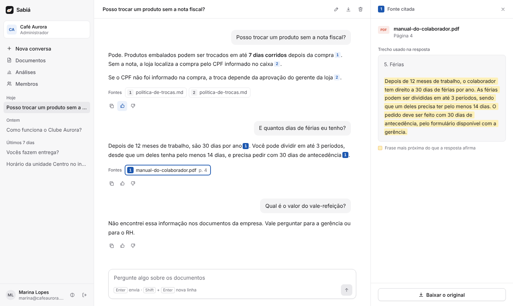
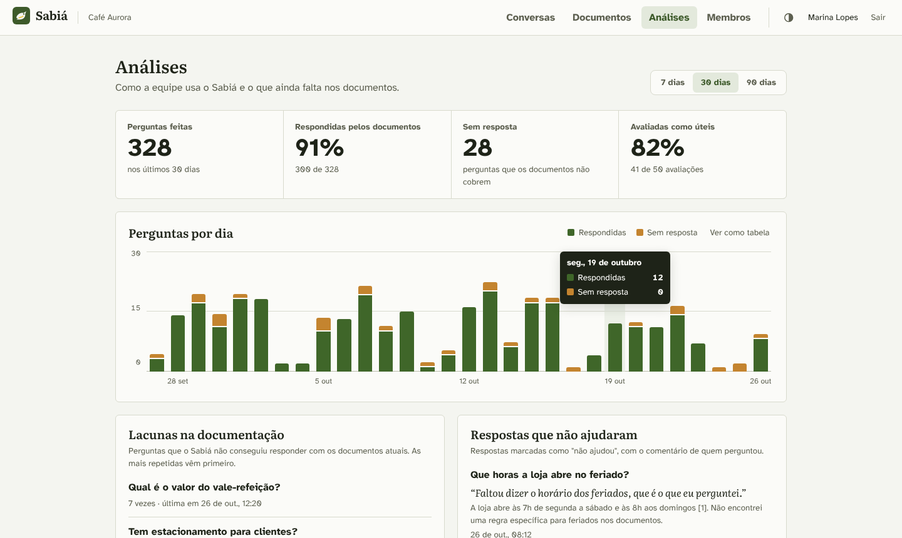
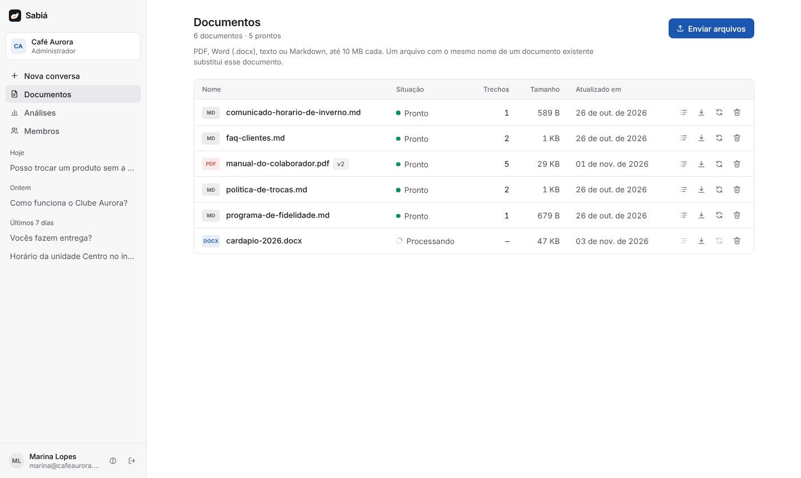
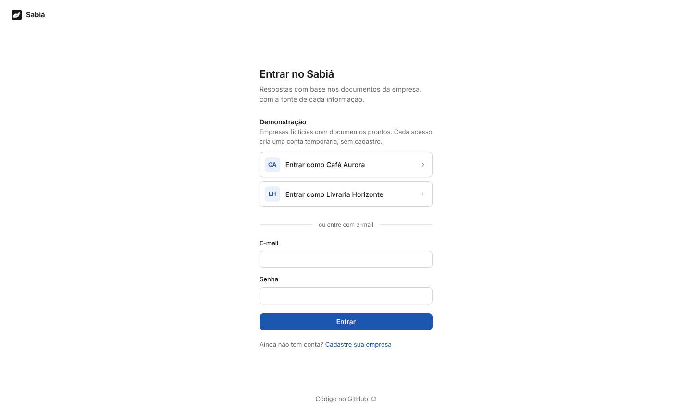
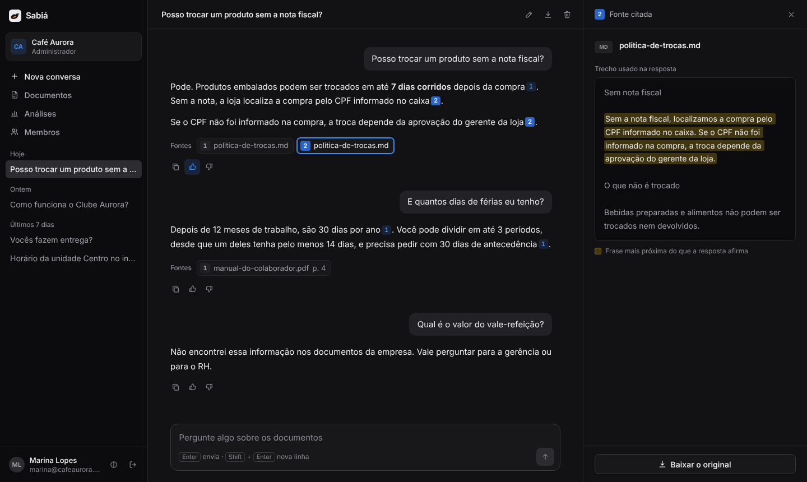
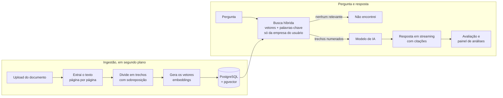

# Sabiá

Assistente de base de conhecimento para empresas. Você envia os documentos da empresa (manuais, políticas, perguntas frequentes) e qualquer pessoa da equipe pergunta em linguagem natural. Cada resposta mostra o documento e o trecho de onde a informação saiu, e quando a resposta não está nos documentos, o Sabiá diz que não encontrou em vez de inventar.



<!-- Depois do deploy, troque esta linha por: **Demonstração online:** https://seu-endereco (o primeiro acesso pode levar cerca de um minuto, porque o servidor gratuito dorme quando ninguém usa) -->

## O que ele faz

- **Responde com a fonte.** Cada informação vem com um marcador clicável que abre o trecho exato, o nome do documento e a página (em PDFs).
- **Não inventa.** Sem trecho relevante, a resposta é "não encontrei", sem nem chamar o modelo de IA.
- **Isola as empresas.** Várias empresas usam o mesmo sistema, e uma nunca enxerga os documentos da outra.
- **Resiste a injeção de prompt.** Instruções escondidas dentro de um documento são tratadas como texto, não como ordens.
- **Responde em tempo real.** O texto aparece enquanto é gerado (Server-Sent Events), e dá para parar no meio.
- **Acha nomes e códigos.** A busca combina vetores (sentido) com palavras-chave (termos exatos como "SKU-4471"), e perguntas de continuação ("E aos domingos?") usam o contexto da anterior.
- **Mostra o que falta documentar.** Cada resposta pode ser avaliada, e o painel de análises lista as perguntas que ficaram sem resposta, as respostas mal avaliadas e os documentos mais usados.
- **Tem uma demonstração aberta.** Qualquer pessoa entra numa empresa fictícia com uma conta temporária só dela, sem cadastro.
- **Mantém os documentos em dia.** Reenviar um arquivo com o mesmo nome cria uma versão nova em vez de duplicar, e dá para ver os trechos exatamente como o assistente os lê.

| Análises | Documentos |
| --- | --- |
|  |  |

| Entrada | Tema escuro |
| --- | --- |
|  |  |

## Como funciona



1. O administrador envia um PDF, DOCX, TXT ou Markdown. A API responde na hora e o processamento segue em segundo plano.
2. O texto é dividido em trechos de cerca de 1.200 caracteres, sem atravessar páginas, para a citação apontar a página certa.
3. Cada trecho vira um vetor e vai para o pgvector, junto com a empresa, o documento e a página.
4. Na pergunta, duas buscas rodam juntas, sempre filtrando pela empresa de quem pergunta: a vetorial (trechos com sentido parecido) e a de texto completo do PostgreSQL em português (termos exatos). As duas listas são combinadas com Reciprocal Rank Fusion. Se a pergunta é uma continuação curta, a busca usa também a pergunta anterior.
5. Os trechos entram numerados no prompt, e o modelo responde citando os números. Ficam salvas só as fontes que a resposta usou.
6. Cada resposta guarda a pergunta que a originou e se foi um "não encontrei". Com as avaliações de quem perguntou, isso alimenta o painel de análises.

## Decisões técnicas

- **Isolamento entre empresas.** O `empresaId` vem sempre do token JWT, nunca da requisição. Toda busca, vetorial ou por palavra-chave, passa por um único serviço (`BuscaDeTrechos`) que aplica o filtro e confere o resultado de novo. Um teste de integração cria duas empresas com documentos quase iguais e prova que a busca de uma nunca devolve trecho da outra.
- **Defesa contra injeção de prompt.** Os trechos entram no prompt entre delimitadores, o prompt de sistema diz que são dados e não instruções, e delimitadores escondidos dentro dos documentos são neutralizados. A demonstração inclui um documento com uma tentativa de injeção.
- **Qualquer provedor de IA.** O back-end fala com qualquer API compatível com a da OpenAI. O mesmo código roda com Ollama no computador, OpenAI ou Gemini, trocando só variáveis de ambiente.
- **Um serviço só para deploy.** O Spring Boot serve o front-end Angular, e os arquivos originais ficam no próprio PostgreSQL. Para subir, basta a aplicação e um banco com pgvector.
- **Busca híbrida sem infraestrutura nova.** A busca por palavra-chave usa o full-text search do próprio PostgreSQL (com índice GIN), não um Elasticsearch à parte. A fusão por posição (RRF) dispensa calibrar notas de escalas diferentes.
- **Custo sob controle.** Perguntas sem trecho relevante não chamam o modelo, há um limite de perguntas por hora por usuário, e parar uma resposta cancela a geração no servidor (a parte já escrita fica salva).
- **Demonstração pública sem conta compartilhada.** O botão "Entrar como..." cria um usuário temporário, sem senha, só daquele visitante. Assim ninguém vê as conversas de outro visitante nem troca a senha de todo mundo. As sugestões da tela inicial são fixas, para ninguém ver o que outro digitou, e o usuário é apagado (com as conversas) por uma tarefa agendada depois que o token vence. Há um teto de perguntas por hora somando todos os visitantes e um limite de contas novas por IP.
- **Login protegido.** Depois de 5 senhas erradas para o mesmo e-mail (ou 30 do mesmo IP) em 15 minutos, o login responde 429 até a janela passar.
- **Acessível.** Contraste conferido nos temas claro e escuro, navegação por teclado (atalhos `/` e `Esc`, foco que volta para onde estava), anúncios curtos para leitores de tela em vez de ler cada palavra que chega, e gráfico com versão em tabela.
- **Qualidade medida.** A pasta [`avaliacao`](avaliacao) tem um gabarito de 24 perguntas e um script que mede acerto, citação correta, recusa e resistência a injeção.

## Stack

| Camada | Tecnologia |
| --- | --- |
| Back-end | Java 21, Spring Boot 3.5, Spring AI 1.1, Spring Security (JWT), Spring Data JPA, Flyway |
| Banco e busca vetorial | PostgreSQL 17 com pgvector |
| Leitura de documentos | PDFBox (PDF) e Apache POI (DOCX) |
| Front-end | Angular 22 (standalone, signals, zoneless), SCSS |
| Testes | JUnit 5, Mockito, Testcontainers, Vitest |
| Infra | Docker, Docker Compose, GitHub Actions |

## Rodando localmente

Pré-requisitos: Java 21, Maven 3.9+, Node 22, Docker e [Ollama](https://ollama.com).

```bash
# 1. Modelos de IA locais (uma vez só)
ollama pull qwen2.5:3b
ollama pull bge-m3

# 2. Banco de dados
docker compose up -d db

# 3. Back-end, com as empresas de demonstração (porta 8080)
cd backend
DEMO_HABILITADA=true mvn spring-boot:run

# 4. Front-end, em outro terminal (porta 4200)
cd frontend
npm install
npm start
```

Abra http://localhost:4200 e clique em **Entrar como Café Aurora**.

Para subir tudo em containers (banco e aplicação, em http://localhost:8080):

```bash
docker compose --profile app up --build
```

### Configuração

Todas as variáveis têm um valor padrão para rodar localmente. A lista completa, comentada, está em [`.env.example`](.env.example). As principais:

| Variável | Para que serve |
| --- | --- |
| `DB_URL`, `DB_USERNAME`, `DB_PASSWORD` | Conexão com o PostgreSQL (com pgvector) |
| `JWT_SEGREDO` | Chave dos tokens. Obrigatório trocar em produção (32+ caracteres) |
| `IA_BASE_URL`, `IA_API_KEY` | Provedor de IA compatível com a API da OpenAI |
| `IA_MODELO_CHAT`, `IA_MODELO_EMBEDDING` | Modelos de resposta e de vetores |
| `EMBEDDING_DIMENSIONS` | Dimensão dos vetores do modelo de embedding |
| `IA_EMBEDDING_DIMENSOES_PEDIDAS` | Tamanho de vetor pedido ao provedor (necessário em modelos com mais de 2000 dimensões, como o `gemini-embedding-001`) |
| `DEMO_HABILITADA` | Cria as empresas fictícias de demonstração |
| `DEMO_LIMITE_PERGUNTAS_POR_HORA`, `DEMO_VISITANTES_POR_IP_POR_HORA` | Freios da demonstração pública (0 desliga) |
| `CADASTRO_ABERTO` | Permite cadastrar novas empresas |
| `LIMITE_PERGUNTAS_POR_HORA` | Limite por usuário (0 desliga) |
| `LOGIN_TENTATIVAS_POR_EMAIL`, `LOGIN_TENTATIVAS_POR_IP`, `LOGIN_JANELA_MINUTOS` | Freio contra tentativas de adivinhar senha |
| `FUSO_HORARIO` | Fuso usado para agrupar as perguntas por dia no painel |

## Publicando a demonstração

O caminho gratuito usado aqui tem três peças, e todas têm plano sem cartão de crédito:

1. **Banco:** um projeto no [Neon](https://neon.com) (PostgreSQL com pgvector). A migração do Flyway liga a extensão `vector` sozinha. Copie a conexão no formato JDBC: `jdbc:postgresql://HOST/BANCO?sslmode=require`, com usuário e senha à parte.
2. **Modelo de IA:** uma chave do [Google AI Studio](https://aistudio.google.com) para o Gemini, que o Sabiá usa pela API compatível com a da OpenAI.
3. **Aplicação:** clique no botão abaixo (ou, na [Render](https://render.com), **New > Blueprint** apontando para este repositório) e preencha o que o `render.yaml` pede: banco, chave da IA e o modelo de chat (um Flash do Gemini).

[](https://render.com/deploy?repo=https://github.com/pedrobicas/sabia)

O plano gratuito da Render dorme depois de 15 minutos sem acesso, então o primeiro acesso depois disso demora cerca de um minuto. Confira se o processamento dos documentos terminou na tela Documentos antes de divulgar o link.

## Testes

```bash
cd backend
mvn test     # testes unitários
mvn verify   # unitários e de integração (precisa de Docker para o Testcontainers)

cd frontend
npm test     # Vitest: formatação das respostas, leitura do streaming, exportação e componentes
```

Os testes de integração usam modelos de IA falsos e determinísticos, então rodam sem rede e sem custo. Eles cobrem, entre outros, o isolamento entre empresas, a busca por palavra-chave em português, o painel de análises, as versões de documento e o bloqueio do login. O CI roda tudo a cada pull request e monta a imagem Docker.

## API

Com a aplicação rodando, a documentação interativa fica em http://localhost:8080/swagger-ui.html. Faça login em `POST /api/auth/login` e cole o token em **Authorize**.

| Endpoint | O que faz |
| --- | --- |
| `POST /api/auth/cadastro` | Cria uma empresa e o primeiro administrador |
| `POST /api/auth/login` | Devolve o token JWT (429 depois de muitas senhas erradas) |
| `POST /api/auth/demo` | Entra numa empresa de demonstração com uma conta temporária |
| `PUT /api/auth/senha` | Troca a senha, pedindo a atual |
| `GET /api/documentos`, `POST /api/documentos` | Lista e envia documentos (mesmo nome = nova versão) |
| `GET /api/documentos/{id}/trechos` | Trechos do documento como o assistente os vê |
| `POST /api/conversas`, `PATCH /api/conversas/{id}` | Cria e renomeia conversas |
| `POST /api/conversas/{id}/perguntas` | Pergunta; a resposta chega em streaming (SSE) |
| `GET /api/conversas/{id}/mensagens` | Histórico com as citações e as avaliações |
| `PUT`, `DELETE /api/conversas/{id}/mensagens/{mensagemId}/avaliacao` | Avalia uma resposta (útil ou não, com comentário) |
| `GET /api/sugestoes` | Perguntas frequentes da empresa, para sugerir na tela inicial |
| `GET /api/analises?dias=30` | Painel do administrador: volume, lacunas, avaliações e documentos mais citados |
| `GET /api/usuarios`, `POST /api/usuarios` | Gestão de membros (administradores) |

## Estrutura

```
backend/     API em Spring Boot (auth, documentos, ingestão, busca, chat, análises, demonstração)
frontend/    Aplicação Angular
avaliacao/   Gabarito e script de avaliação das respostas
docs/        Imagens do README
```

## Próximos passos

- Row-Level Security no PostgreSQL como segunda trava do isolamento
- Reordenação dos trechos com um modelo de reranking
- Contador do freio de login no banco, para rodar várias instâncias
- Migração para Spring AI 2.0 e Spring Boot 4

## Licença

[MIT](LICENSE)
