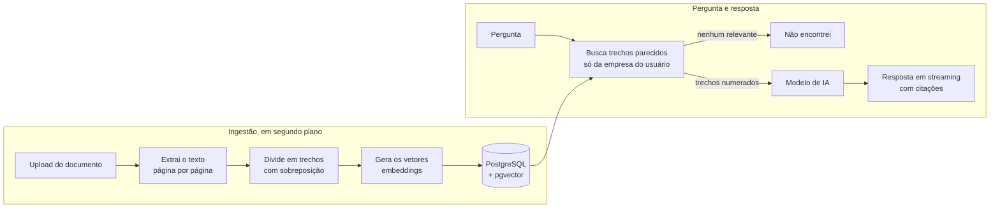

# Sabiá

Assistente de base de conhecimento para empresas. Você envia os documentos da empresa (manuais, políticas, perguntas frequentes) e qualquer pessoa da equipe pergunta em linguagem natural. Cada resposta mostra o documento e o trecho de onde a informação saiu, e quando a resposta não está nos documentos, o Sabiá diz que não encontrou em vez de inventar.


<!-- Depois do deploy, adicione aqui: **Demonstração online:** https://seu-endereco -->

## O que ele faz

- **Responde com a fonte.** Cada informação vem com um marcador clicável que abre o trecho exato, o nome do documento e a página (em PDFs).
- **Não inventa.** Sem trecho relevante, a resposta é "não encontrei", sem nem chamar o modelo de IA.
- **Isola as empresas.** Várias empresas usam o mesmo sistema, e uma nunca enxerga os documentos da outra.
- **Resiste a injeção de prompt.** Instruções escondidas dentro de um documento são tratadas como texto, não como ordens.
- **Responde em tempo real.** O texto aparece enquanto é gerado (Server-Sent Events).

| Entrada | Documentos |
| --- | --- |
|  |  |

## Como funciona



1. O administrador envia um PDF, DOCX, TXT ou Markdown. A API responde na hora e o processamento segue em segundo plano.
2. O texto é dividido em trechos de cerca de 1.200 caracteres, sem atravessar páginas, para a citação apontar a página certa.
3. Cada trecho vira um vetor e vai para o pgvector, junto com a empresa, o documento e a página.
4. Na pergunta, a busca traz os trechos mais parecidos, sempre filtrando pela empresa de quem pergunta.
5. Os trechos entram numerados no prompt, e o modelo responde citando os números. Ficam salvas só as fontes que a resposta usou.

## Decisões técnicas

- **Isolamento entre empresas.** O `empresaId` vem sempre do token JWT, nunca da requisição. Toda busca vetorial passa por um único serviço (`BuscaDeTrechos`) que aplica o filtro e confere o resultado de novo. Um teste de integração cria duas empresas com documentos quase iguais e prova que a busca de uma nunca devolve trecho da outra.
- **Defesa contra injeção de prompt.** Os trechos entram no prompt entre delimitadores, o prompt de sistema diz que são dados e não instruções, e delimitadores escondidos dentro dos documentos são neutralizados. A demonstração inclui um documento com uma tentativa de injeção.
- **Qualquer provedor de IA.** O back-end fala com qualquer API compatível com a da OpenAI. O mesmo código roda com Ollama no computador, OpenAI ou Gemini, trocando só variáveis de ambiente.
- **Um serviço só para deploy.** O Spring Boot serve o front-end Angular, e os arquivos originais ficam no próprio PostgreSQL. Para subir, basta a aplicação e um banco com pgvector.
- **Custo sob controle.** Perguntas sem trecho relevante não chamam o modelo, e há um limite de perguntas por hora por usuário.
- **Qualidade medida.** A pasta [`avaliacao`](avaliacao) tem um gabarito de 24 perguntas e um script que mede acerto, citação correta, recusa e resistência a injeção.

## Stack

| Camada | Tecnologia |
| --- | --- |
| Back-end | Java 21, Spring Boot 3.5, Spring AI 1.1, Spring Security (JWT), Spring Data JPA, Flyway |
| Banco e busca vetorial | PostgreSQL 17 com pgvector |
| Leitura de documentos | PDFBox (PDF) e Apache POI (DOCX) |
| Front-end | Angular 22 (standalone e signals), SCSS |
| Testes | JUnit 5, Mockito, Testcontainers |
| Infra | Docker, Docker Compose, GitHub Actions |

## Rodando localmente

Pré-requisitos: Java 21, Maven 3.9+, Node 22, Docker e [Ollama](https://ollama.com).

```bash
# 1. Modelos de IA locais (uma vez só)
ollama pull qwen2.5:3b
ollama pull bge-m3

# 2. Banco de dados
docker compose up -d db

# 3. Back-end, com as empresas de demonstração (porta 8080)
cd backend
DEMO_HABILITADA=true mvn spring-boot:run

# 4. Front-end, em outro terminal (porta 4200)
cd frontend
npm install
npm start
```

Abra http://localhost:4200 e clique em **Entrar como Café Aurora**.

Para subir tudo em containers (banco e aplicação, em http://localhost:8080):

```bash
docker compose --profile app up --build
```

### Configuração

Todas as variáveis têm um valor padrão para rodar localmente. A lista completa, comentada, está em [`.env.example`](.env.example). As principais:

| Variável | Para que serve |
| --- | --- |
| `DB_URL`, `DB_USERNAME`, `DB_PASSWORD` | Conexão com o PostgreSQL (com pgvector) |
| `JWT_SEGREDO` | Chave dos tokens. Obrigatório trocar em produção (32+ caracteres) |
| `IA_BASE_URL`, `IA_API_KEY` | Provedor de IA compatível com a API da OpenAI |
| `IA_MODELO_CHAT`, `IA_MODELO_EMBEDDING` | Modelos de resposta e de vetores |
| `EMBEDDING_DIMENSIONS` | Dimensão dos vetores do modelo de embedding |
| `DEMO_HABILITADA` | Cria as empresas fictícias de demonstração |
| `CADASTRO_ABERTO` | Permite cadastrar novas empresas |
| `LIMITE_PERGUNTAS_POR_HORA` | Limite por usuário (0 desliga) |

## Testes

```bash
cd backend
mvn test     # testes unitários
mvn verify   # unitários e de integração (precisa de Docker para o Testcontainers)
```

Os testes de integração usam modelos de IA falsos e determinísticos, então rodam sem rede e sem custo. O CI roda tudo a cada pull request e monta a imagem Docker.

## API

Com a aplicação rodando, a documentação interativa fica em http://localhost:8080/swagger-ui.html. Faça login em `POST /api/auth/login` e cole o token em **Authorize**.

| Endpoint | O que faz |
| --- | --- |
| `POST /api/auth/cadastro` | Cria uma empresa e o primeiro administrador |
| `POST /api/auth/login` | Devolve o token JWT |
| `GET /api/documentos`, `POST /api/documentos` | Lista e envia documentos |
| `POST /api/conversas` | Cria uma conversa |
| `POST /api/conversas/{id}/perguntas` | Pergunta; a resposta chega em streaming (SSE) |
| `GET /api/conversas/{id}/mensagens` | Histórico com as citações |
| `GET /api/usuarios`, `POST /api/usuarios` | Gestão de membros (administradores) |

## Estrutura

```
backend/     API em Spring Boot (auth, documentos, ingestão, busca, chat, demonstração)
frontend/    Aplicação Angular
avaliacao/   Gabarito e script de avaliação das respostas
docs/        Imagens do README
```

## Próximos passos

- Row-Level Security no PostgreSQL como segunda trava do isolamento
- Painel com as perguntas que ficaram sem resposta, para a empresa saber o que documentar
- Feedback de cada resposta (útil ou não)
- Busca híbrida (palavra-chave e vetores) e reordenação dos trechos
- Migração para Spring AI 2.0 e Spring Boot 4

## Licença

[MIT](LICENSE)
